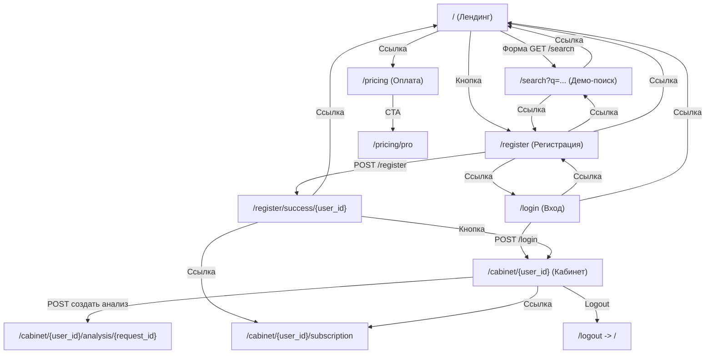
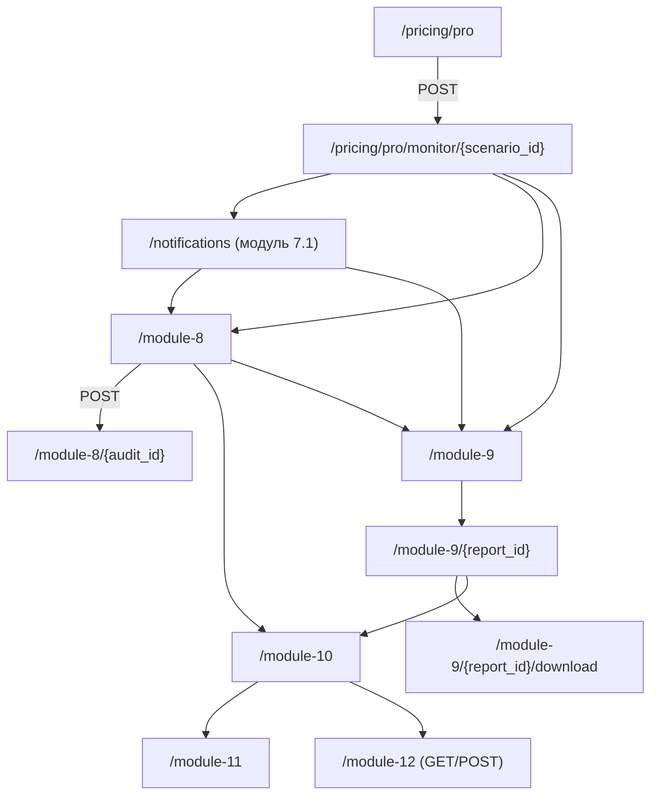

# Geonetix: структура страниц и переходов

Дата фиксации: 2026-05-27  
База: `http://127.0.0.1:8080`

## 1) Основная пользовательская ветка (публичные страницы)

## 2) PRO-ветка модулей (из роутера)

## 3) Порядок блоков на лендинге `/`

1. Hero-блок: заголовок + форма `GET /search` + CTA на `/register`.
2. Блок "Что уже заложено в продукт".
3. Блок "Частые вопросы".
4. Финальный CTA-блок: ссылки на `/search`, `/register`, `/pricing`.

## 4) Локальные визуальные артефакты

- Сырые HTML-снимки страниц сохранены в `artifacts/site-snapshots/`:
  - `01-home.html`
  - `02-search-demo.html`
  - `03-register.html`
  - `04-login.html`
  - `05-pricing.html`

## 5) PNG-скриншоты (desktop + mobile)

Файлы сохранены в `artifacts/site-screenshots/`:

- `01-home-desktop.png`
- `01-home-mobile.png`
- `02-search-demo-desktop.png`
- `02-search-demo-mobile.png`
- `03-register-desktop.png`
- `03-register-mobile.png`
- `04-login-desktop.png`
- `04-login-mobile.png`
- `05-pricing-desktop.png`
- `05-pricing-mobile.png`

## 6) Быстрая логика "что за чем идёт"

1. `/` (лендинг): Hero + CTA -> ведёт в демо-поиск (`/search`) или регистрацию (`/register`), также есть переход в тарифы (`/pricing`).
2. `/search`: показывает демо-результаты -> ключевой переход в регистрацию (`/register`).
3. `/register`: создание аккаунта (POST) -> `/register/success/{user_id}`.
4. `/register/success/{user_id}`: точка входа в кабинет -> `/cabinet/{user_id}` и в подписку.
5. `/login`: альтернативный вход в тот же кабинет.
6. `/pricing` -> `/pricing/pro`: запуск платной ветки с мониторингом и модулями 7.1/8/9/10/11/12.
